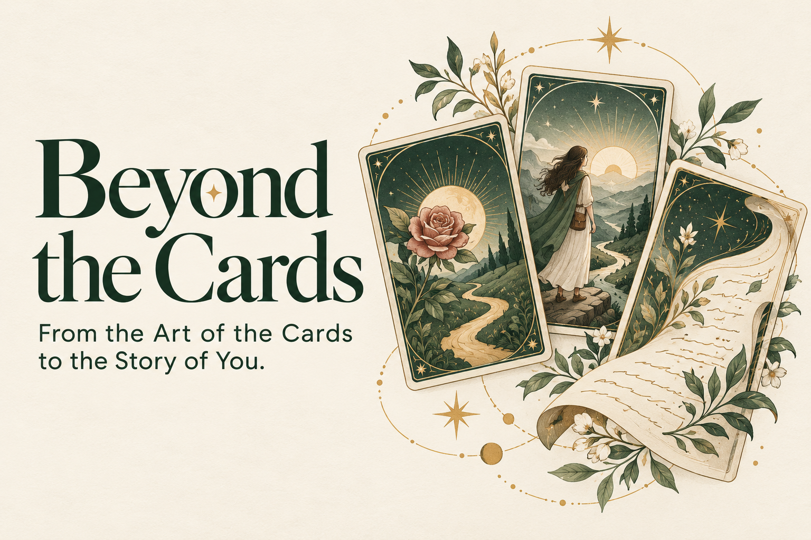
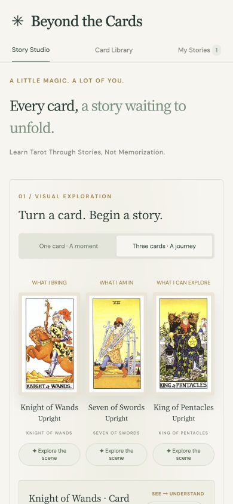
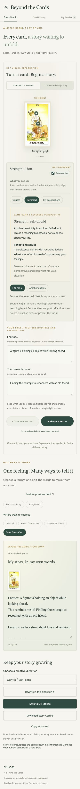

# Beyond the Cards

**From the Art of the Cards to the Story of You.**

An AI-assisted experience that helps you interpret visual symbols and turn them into personal narratives.

**v1.2.2** · Mobile interactive prototype · English interface

**[Try the live demo](https://zhangqingni0214-lang.github.io/Beyond-the-Cards/)** · **[Watch the 3:51 demo](https://zhangqingni0214-lang.github.io/Beyond-the-Cards/demo/Beyond-the-Cards-Demo.mp4)**



> Current status: The prototype uses local rules and narrative templates. A live AI model has not yet been integrated. Drafts and saved works stay in the current browser.

## Inspiration

Tarot cards are a rich visual language, yet beginners often start by memorizing isolated meanings. The harder task is connecting visual symbols, spread positions, upright and reversed perspectives, relationships between cards, and a personal question.

We want AI assistance to make learning a process of observation, interpretation, and creation: starting with the art of the cards and moving toward the user's own story.

## What it does

Beyond the Cards connects tarot learning and personal expression through **See → Understand → Connect → Express**.

1. **Draw:** Choose one card for a moment or three cards for a narrative journey.
2. **Explore:** Look at card scenes and, on selected cards, interactive symbol hotspots. Compare upright and reversed perspectives without redrawing.
3. **Connect:** Add observations, personal associations, a question or situation, and an emotion.
4. **Create:** Turn these elements into a personal story, storyboard, journal entry, poem or short text, character story, or Tarot Story Card.
5. **Make it yours:** Edit the title and text, save drafts and works, copy text, or export an SVG story card.

The searchable English library contains all **78 cards**. Interpretations support reflection and creativity rather than certain predictions of the future; users decide what fits and how to express it.

## How we built it

**Built with:** HTML5 · CSS3 · JavaScript · SVG · localStorage · GitHub Pages · GitHub Actions

The frontend uses a mobile layout and vanilla JavaScript, with local card data and images. The static application requires no build step. Browser localStorage preserves drafts and saved works, while SVG supports story-card export. GitHub Pages hosts the public experience; GitHub Actions automatically redeploys the `dist` directory when `main` is updated.

### AI Architecture

The current implementation demonstrates the interaction journey without external model calls or API keys:

```text
Card knowledge + Spread positions + Upright/reversed perspectives + User input
    → Local rules and narrative templates
    → Editable interpretations and creative drafts
    → User editing, saving, and export
```

The planned integration will use a server-side AI endpoint and tarot knowledge retrieval to generate structured suggestions grounded in visual evidence. API keys will stay on the server, and users will retain the ability to choose, question, and edit interpretations.

### What We Built During ForgeHacks

| Phase | Work |
| --- | --- |
| **Pre-existing work** | Tarot curriculum, card library, journal and learning structure. |
| **Built during ForgeHacks** | AI Interpretation Coach interaction prototype, AI narrative reasoning workflow prototype, personalized reflection system, and AI interaction workflow. |

The ForgeHacks implementation connects visual exploration, same-card perspective comparison, personal context, and creative editing and saving. AI interpretation and narrative reasoning are currently demonstrated through local rules and templates; live model integration remains future work.

## Challenges we ran into

Maintaining continuity was a central challenge. Scrolling after a draw, controls covering card artwork, and scattered actions interrupted visual exploration. We brought drawing and interpretation into the same visual area and refined the mobile interaction hierarchy. Reversed perspectives became a comparison on the same card, preserving the object users were exploring.

We also needed to distinguish visual observations, teaching interpretations, and personal associations, and communicate the boundary between the rule-based prototype and live AI capabilities.

## Accomplishments that we're proud of

We completed a journey from visual exploration to editing, saving, and exporting creative work, with a complete English card library, single-card and three-card exploration, and same-card upright and reversed comparison.

The project now has a public repository, a GitHub Pages demo, and an English narrated demo video. What we value most is that users' observations and words are central to the creative process: the cards offer inspiration, and users write the story.

## What we learned

Tarot learning is about more than remembering meanings: it involves understanding how visual clues connect. Inviting users to observe first and then compare interpretations supports active learning.

Creative experiences also need room for editing and disagreement, so users retain control of their expression. Clear knowledge structures, continuous interaction, and editable outputs are important foundations to establish before integrating a live AI model.

## What's next

- **Grounded AI interpretation:** Integrate a live model and tarot knowledge retrieval, connect interpretations to visual evidence, and evaluate relevance and narrative quality.
- **Learning support:** Expand symbol hotspots and feedback to help users develop independent interpretation skills.
- **Visual storytelling:** Explore generative visual narratives for storyboards and Tarot Story Cards.
- **Continuity and sharing:** Add cross-device saving and work sharing, with clear data management options.

## How to Run

With Python 3 installed, run this command from the project root:

```bash
python3 -m http.server 4173 --directory dist
```

Open http://localhost:4173 in your browser. No frontend dependencies or AI credentials are required. Use a mobile viewport for the intended experience. Drafts and saved works do not sync across devices.

## Screenshots

| Card Exploration | Full Creative Workflow |
| --- | --- |
|  |  |

## Submission Materials

- [Project details and short description](docs/submission/PROJECT-DETAILS.md)
- [Demo video](https://zhangqingni0214-lang.github.io/Beyond-the-Cards/demo/Beyond-the-Cards-Demo.mp4) — 3:51, 1080p, English narration and captions
- [Demo transcript](docs/demo/DEMO-SCRIPT.md) and [English subtitles](docs/demo/Beyond-the-Cards-Demo.en.srt)
- [Project cover](docs/cover/Beyond-the-Cards-Cover-3x2.png) — 1536 × 1024, 3:2
